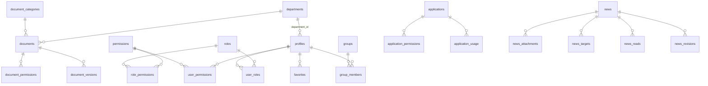

# สถาปัตยกรรมระบบ — Company Intranet Portal

## 1. ภาพรวม

```
 Browser (HTML + ES Modules, ไม่มี build step)
   │  supabase-js  (anon / publishable key เท่านั้น)
   ▼
 Supabase
   ├─ Auth (GoTrue) ............ Email/Password, Microsoft Entra ID (azure) ในอนาคต
   ├─ Data API (PostgREST) ..... ทุก query ผ่าน Row Level Security
   ├─ Postgres
   │    ├─ public  ............. ตารางข้อมูล + RPC ที่อนุญาตให้เรียก
   │    └─ private ............. ฟังก์ชันตรวจสิทธิ์ (ไม่ถูก expose ผ่าน API)
   ├─ Storage (private buckets) . documents, news  → Signed URL อายุสั้น
   └─ Edge Function admin-users  ใช้ service_role ฝั่งเซิร์ฟเวอร์เท่านั้น
```

หลักการ: **ฐานข้อมูลคือผู้ตัดสินสิทธิ์เพียงจุดเดียว** หน้าเว็บซ่อนปุ่มเพื่อความสะดวกเท่านั้น
ทุกการอ่าน/เขียนถูกตรวจซ้ำด้วย RLS, trigger และ RPC ที่ตรวจสิทธิ์ในตัว

## 2. Frontend

| ไฟล์ | หน้าที่ |
|---|---|
| `web/index.html` | โหลดฟอนต์, DOMPurify, Quill, `js/env.js`, `js/app.js` |
| `web/js/app.js` | bootstrap, hash router, app shell (sidebar/topbar), ตรวจบัญชีปิดใช้งาน |
| `web/js/supabase.js` | สร้าง client และ **ปฏิเสธ service_role / sb_secret key** |
| `web/js/api.js` | session state, `can()`, lookups, signed URL, favorites, เรียก Edge Function |
| `web/js/ui.js` | escape HTML, sanitize, toast, modal, loading/empty/error state, formatter |
| `web/js/pages/*.js` | auth, dashboard, documents, applications, news, favorites, search, profile, admin |

- ไม่มีขั้นตอน build: deploy โฟลเดอร์ `web/` เป็น static site ได้ทันที (Nginx, IIS, Netlify, Cloudflare Pages, Vercel, Azure Static Web Apps)
- ข้อความทุกจุดที่มาจากข้อมูลถูก `esc()` ก่อนใส่ HTML; เนื้อหาข่าว (rich text) ผ่าน DOMPurify ทั้งตอนบันทึกและตอนแสดง
- `js/i18n.js` เตรียมพจนานุกรม th/en สำหรับเมนูและคำสั่งร่วม (ขยายเพิ่มได้)

## 3. โมเดลสิทธิ์ (RBAC + สิทธิ์รายรายการ)

**ชั้นที่ 1 — บทบาท → permission code** (`roles`, `permissions`, `role_permissions`)

| Permission | Super Admin | IT Admin | Dept Manager | Employee |
|---|:-:|:-:|:-:|:-:|
| users.view / users.manage / roles.assign | ✓ | ✓ (เฉพาะผู้ใช้ระดับต่ำกว่า) | – | – |
| roles.manage, user_permissions, role matrix | ✓ | – | – | – |
| departments.manage | ✓ | – | – | – |
| groups.manage, doc_categories.manage | ✓ | ✓ | – | – |
| documents.upload | ✓ | ✓ | ✓ (แผนกตนเอง) | – |
| documents.approve | ✓ | – | ✓ | – |
| documents.manage_all (รวม Restricted) | ✓ | – | – | – |
| apps.manage, news.manage, settings.manage | ✓ | – | – | – |
| news.create (ข่าวของแผนก) | ✓ | – | ให้รายบุคคล | ให้รายบุคคล |
| audit.view, storage.view | ✓ | ✓ | – | – |

Super Admin ได้ทุก permission โดยอัตโนมัติ (`private.has_permission`)

**ชั้นที่ 2 — สิทธิ์รายบุคคล** (`user_permissions`, มีวันหมดอายุได้) — Super Admin เท่านั้นที่มอบได้

**ชั้นที่ 3 — สิทธิ์รายรายการ** ต่อเอกสาร/ระบบงาน/ข่าว ให้ได้กับ ผู้ใช้ · กลุ่ม · แผนก · บทบาท
(`document_permissions`, `application_permissions`, `news_targets`)

**ระดับบทบาท (level)**: จัดการผู้ใช้/มอบบทบาทได้เฉพาะกับผู้ที่มีระดับต่ำกว่าตนเอง ห้ามมอบบทบาทให้ตนเอง
และต้องมี Super Admin ที่ใช้งานอยู่อย่างน้อย 1 คนเสมอ

### กฎการเข้าถึงเอกสาร (`private.can_doc(doc, action)`)

ลำดับการตัดสิน (action = view | download | upload | edit | delete | share):

1. ผู้ใช้ต้อง login และบัญชี `is_active`
2. `documents.manage_all` → อนุญาตทั้งหมด
3. เจ้าของ (`owner_id`) หรือผู้อัปโหลด (`created_by`) → อนุญาตทั้งหมด
4. ผู้จัดการแผนกที่รับผิดชอบ → อนุญาตทั้งหมด **ยกเว้น Restricted**
5. เอกสารในถังขยะ → เห็นได้เฉพาะผู้มีสิทธิ์ลบ (เพื่อกู้คืน)
6. เอกสารรออนุมัติ → ผู้อนุมัติในแผนกเดียวกันดู/ดาวน์โหลดได้
7. ยังไม่ published → ปฏิเสธ
8. สิทธิ์ที่ให้ไว้ (`document_permissions`) ตาม flag view/download/upload/edit/delete
   — **Restricted รับเฉพาะสิทธิ์รายบุคคล** (สิทธิ์แบบกลุ่ม/แผนก/บทบาทไม่มีผล)
9. ระดับพื้นฐาน: Public → ทุกคนดู/ดาวน์โหลด, Department → สมาชิกแผนกดู/ดาวน์โหลด

IT Admin ไม่มี `documents.manage_all` จึง **ไม่เห็นเอกสารที่จำกัดสิทธิ์โดยอัตโนมัติ**

## 4. Database schema



ตารางตามที่กำหนด + ตารางเสริมที่จำเป็น: `permissions`, `role_permissions`, `user_permissions`,
`application_usage` (ระบบที่ใช้บ่อย), `news_revisions` (ประวัติแก้ไขข่าว)

- PK เป็น `uuid` (audit_logs เป็น identity bigint), FK ครบพร้อม `on delete` ที่เหมาะสม
- `created_at / updated_at / created_by / updated_by` ตั้งค่าด้วย trigger — **ผู้ใช้ปลอม `created_by` ไม่ได้**
- Index: FK ทุกตัวที่ใช้กรอง, `created_at/updated_at desc`, GIN บน `tags`, trigram บน `search_text`
- `doc_number` **ไม่ unique** โดยเจตนา: ถ้า unique ข้อความ error จะเผยว่ามีเอกสารลับเลขนั้นอยู่

## 5. Storage

| Bucket | Public | ขนาดสูงสุด | ประเภทไฟล์ | Path |
|---|---|---|---|---|
| documents | ❌ | 50 MB | PDF, Office, JPG, PNG, TXT, CSV, ZIP | `<document_id>/v<n>-<ts>-<safe-name>` |
| news | ❌ | 20 MB | รูปภาพ, PDF, Office | `<news_id>/<cover|att>-<ts>-<safe-name>` |

- Policy ของ `storage.objects` เรียก `private.can_doc()` / `can_view_news()` จาก **folder แรกของ path**
  ดังนั้นการเดา/เปลี่ยน URL หรือ ID ไม่ได้ผล และ Signed URL จะออกให้เฉพาะผู้มีสิทธิ์
- ไม่มี UPDATE policy: ทุกเวอร์ชันเป็นไฟล์ใหม่ (immutable) — ขนาดและ MIME ที่บันทึกในตารางดึงจาก Storage ไม่ใช่จากเบราว์เซอร์
- ข้อจำกัดที่ต้องรู้: สิทธิ์ "ดูอย่างเดียว" อนุญาต preview PDF/รูปภาพผ่าน Signed URL — เบราว์เซอร์ได้รับไบต์ของไฟล์จริง
  จึงไม่สามารถกันการบันทึกไฟล์ได้ 100% ถ้าต้องการเข้มงวด ให้ให้สิทธิ์ view เฉพาะไฟล์ที่ไม่ใช่ PDF/รูป หรือพัฒนา viewer ฝั่งเซิร์ฟเวอร์ (watermark) ใน Phase ถัดไป

## 6. RPC (เรียกผ่าน `supabase.rpc`)

`my_context`, `touch_last_login`, `log_event` (whitelist), `my_document_rights`, `add_document_version`,
`discard_document_draft`, `soft_delete_document`, `restore_document`, `review_document`,
`my_expiring_documents`, `track_application_open`, `reorder_applications`, `mark_news_read`,
`news_read_count`, `storage_stats`, `can_manage_user` — ทุกตัวตรวจสิทธิ์เอง, `anon` เรียกไม่ได้

## 7. Audit

Trigger `private.audit_row` บันทึกการ insert/update/delete ของตารางสิทธิ์ ผู้ใช้ แผนก กลุ่ม เอกสาร ระบบ ข่าว และการตั้งค่า
(เก็บเฉพาะคอลัมน์ที่เปลี่ยน) และ RPC บันทึกเหตุการณ์ธุรกิจ: login, อัปโหลดเวอร์ชัน, ลบ/กู้คืน, อนุมัติ,
preview/download, สร้างผู้ใช้, ส่งลิงก์รีเซ็ตรหัสผ่าน — ตาราง `audit_logs` อ่านได้อย่างเดียวผ่าน API

## 8. Phase ถัดไปที่แนะนำ

- SSO Microsoft 365: เปิด Azure provider ใน Supabase แล้วเปิด `auth.microsoft_enabled` (โค้ดหน้า Login รองรับแล้ว)
- ซิงก์ผู้ใช้/แผนกจาก Entra ID (Graph API) ผ่าน Edge Function ตามรอบเวลา
- แจ้งเตือนเอกสารใกล้หมดอายุทางอีเมล (pg_cron + Edge Function)
- ลบไฟล์ข่าว/เอกสารที่ค้าง (orphan) จากการอัปโหลดที่ล้มเหลว ด้วยงานทำความสะอาดตามรอบเวลา
- Full-text search ภาษาไทยด้วยการตัดคำ (ปัจจุบันใช้ trigram/ILIKE ซึ่งค้นภาษาไทยได้แบบ substring)
